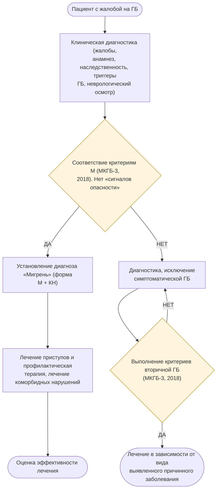

# Мигрень — алгоритм действий врача

Источник: https://cr.minzdrav.gov.ru/view-cr/295_4

> Схема распознана автоматически по изображению: текст блоков близок к дословному, но около 20% стрелок могут быть пропущены или направлены неверно. Ветвления и схемы с quality=check сверяйте с оригиналом по source_url.

## Изображение 1 — quality: ok

